# SERP Rank Lab

> Ранжирование по релевантности оптимизирует NDCG, а ранжирование по комиссии зарабатывает **на 38% больше на поиск** — офлайн-метрика и деньги едут в разные стороны.

Лаборатория аналитики **страницы результатов поиска** в метапоиске авиабилетов:
ранжирование, смещение позиции, монетизация партнёров и ридаут A/B-теста — на той
поверхности, где метапоиск действительно зарабатывает.

Метапоиск не продаёт билеты. Его выручка — комиссия партнёра (CPA за бронь) или
плата за клик, умноженная на **позицию**, которую предложение заняло на странице
результатов. Поэтому роль определяют два вопроса:

1. **Ранжирование** — какое предложение достойно какой позиции и до какой глубины
   пользователь вообще долистывает перед покупкой?
2. **Монетизация** — какие партнёры и какие позиции отрабатывают свой слот и
   сколько выручки приносит конкретная политика ранжирования на один поиск?

Лаборатория сначала строит измерительную основу для обоих вопросов, а затем
прогоняет на ней машинерию эксперимента.

## Навигация

- 🌐 [Сайт портфолио](https://nikitaboyarkin.github.io)
- 🏦 [Флагманский кейс: Volta neobank](https://github.com/NikitaBoyarkin/volta-banking)
- 🧪 Связанные: [ab_test](https://github.com/NikitaBoyarkin/ab_test) · [causal-uplift](https://github.com/NikitaBoyarkin/causal-uplift) · [browser-mini-games](https://github.com/NikitaBoyarkin/browser-mini-games)

**На этой странице:** [Ситуация](#ситуация) · [Задача](#задача) · [Действия](#действия) · [Результат](#результат) · [Результаты](#результаты) · [Выводы](#выводы) · [Рекомендации](#рекомендации) · [Методы](#методы) · [Быстрый старт](#быстрый-старт) · [Структура](#структура)

- [Что делает](#что-делает)
- [Как устроен пайплайн](#как-устроен-пайплайн)
- [Результаты](#результаты)
  - [Ранжирование: офлайн-метрика и деньги расходятся](#ранжирование-офлайн-метрика-и-деньги-расходятся)
  - [Дивергенция не артефакт одной кривой](#дивергенция-не-артефакт-одной-кривой)
  - [Смещение позиции реально и корректируется](#смещение-позиции-реально-и-корректируется)
  - [Воронка и затухание выручки по позициям](#воронка-и-затухание-выручки-по-позициям)
  - [Какие партнёры оправдывают слот](#какие-партнёры-оправдывают-слот)
  - [Ридаут эксперимента](#ридаут-эксперимента)
  - [Необходимый размер выборки](#необходимый-размер-выборки)
  - [Измеренные острова: заказы, предложение, маршруты](#измеренные-острова-заказы-предложение-маршруты)
- [Выводы](#выводы)
- [Рекомендации](#рекомендации)
- [Данные](#данные)
- [Методы](#методы)
- [Быстрый старт](#быстрый-старт)
- [Статус](#статус)
- [Структура](#структура)
- [Происхождение](#происхождение)
- [Связанное](#связанное)

## Ситуация

Метапоиск авиабилетов не продаёт билеты: его выручка — это комиссия партнёра (CPA за бронь) или плата за клик, умноженная на позицию предложения на странице результатов. Поэтому роль поверхности определяют два вопроса — ранжирование (какое предложение достойно какой позиции) и монетизация (какие партнёры и слоты отрабатывают себя). Измерительной основы для обоих вопросов на этой поверхности не существовало.

## Задача

Построить измерительную основу для ранжирования и монетизации SERP и прогнать на ней машинерию эксперимента — от несмещённого CTR до ридаута A/B-теста.

## Действия

- Нормализовать реальные ленты броней в одну строку на сегмент перелёта и восстановить сессии правилом 30 минут неактивности + граница суток.
- Построить синтетический SERP поверх реальных пар маршрут/цена с клик-моделью смещения позиции `(1/k)^η` и экономикой партнёров CPA/CPC.
- Реализовать оракульные и «боевые» политики ранжирования (`price_asc`, `click_trained`, `propensity_logistic`).
- Оценить ранжирование несмещённым CTR, NDCG@10, MRR и team-draft interleaving, а также выручкой на поиск.
- Прогнать эксперимент: SRM, A/A, дельта-метод, CUPED, mSPRT и измерение цены подглядывания.
- Якорить ручки симулятора только по измеренным островам, не сливая смоделированный слой с измеренным.

## Результат

- **на 38% больше** — выручка на поиск у `revenue`-оракула против `relevance` (1,196.6 против 868.9).
- **+19.3%** — прирост выручки от IPW-взвешивания логов при том же фиттере (826.6 против 693.0).
- **47.3%** — доля выручки, приходящаяся на позицию 1; топ-5 партнёров дают 99.3% комиссии.
- **почти в 4 раза** — наивный CTR занижает истинную склонность к клику (0.163 против 0.629).
- **0.25%** — FPR always-valid mSPRT против 14.5% при десяти взглядах на p-value.

## Что делает

| Слой | Файлы | Роль |
|---|---|---|
| Данные | `src/data_ingest.py`, `sql/01_normalize.sql` | лента броней → одна строка на сегмент перелёта; заказы; сырые события |
| Сессии | `src/sessions.py`, `sql/02_sessions.sql` | правило сессии: 30 минут неактивности + граница суток |
| SERP | `src/serp_sim.py`, `src/calibration.py` | синтетические страницы результатов на **реальных** парах маршрут/цена; клик-модель со смещением позиции; экономика партнёров CPA/CPC |
| Политики | `src/policies.py` | оракульные и «боевые» ранжировщики: `price_asc`, `click_trained`, `propensity_logistic` |
| Оценка | `src/ranking_eval.py`, `sql/03_funnel.sql`, `sql/04_revenue_per_search.sql` | несмещённый CTR, NDCG/MRR, interleaving, выручка на поиск |
| Эксперимент | `src/stats.py`, `src/experiment.py` | SRM, A/A, дельта-метод, CUPED, mSPRT, подглядывание |
| Поверхность | `app.py`, `run.py` | дашборд на Streamlit; единая точка входа пайплайна |

## Как устроен пайплайн

Каждая стадия читает и пишет `data/processed/` в формате Parquet, поэтому любую
стадию можно перезапустить отдельно. **Смоделированная** ветка (синтетический SERP
поверх реальных пользователей) и **измеренная** (реальные ленты) никогда не
сливаются — см. `docs/adr/0001-modeled-vs-measured.md`.

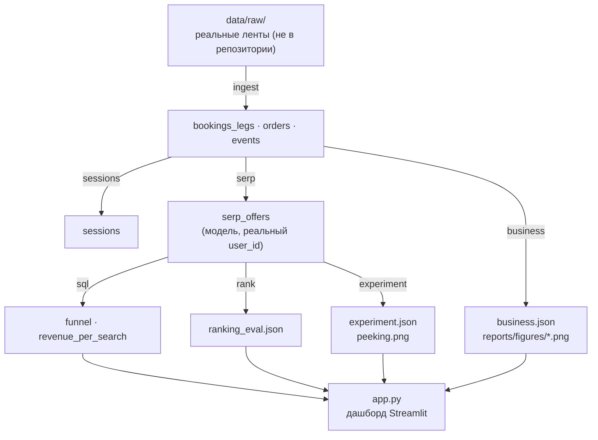

```bash
uv run python run.py --stage all      # ingest → sessions → serp → sql → rank → experiment → business
```

## Результаты

Все числа ниже воспроизводятся с фиксированным сидом (`uv run python run.py --stage all`).
Графики лежат в `reports/figures/` и перерисовываются пайплайном.

### Ранжирование: офлайн-метрика и деньги расходятся

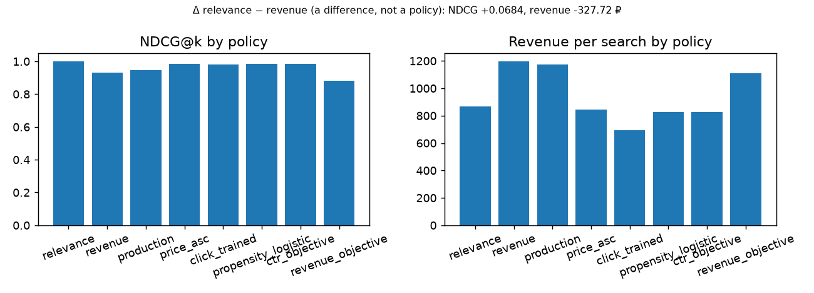

| Политика | Что видит | NDCG@10 | Выручка / поиск | Клики / поиск |
|---|---|---|---|---|
| `relevance` (оракул) | релевантность | **1.000** | 868.9 | **1.760** |
| `revenue` (оракул) | комиссию | 0.932 | **1,196.6** | 1.592 |
| `price_asc` | только цену | 0.985 | 843.9 | 1.723 |
| `click_trained` | сырые логи кликов | 0.982 | 693.0 | 1.713 |
| `propensity_logistic` | логи, взвешенные IPW | 0.985 | 826.6 | 1.722 |
| Δ (`relevance` − `revenue`) | — | **+0.068** | **−327.7** | +0.168 |

Первая пара — оракулы: они видят эталонную релевантность симулятора, поэтому к ним
можно было бы отнестись как к «сравнили идеальное с жадным». Три нижние политики —
те, что команда реально может выкатить: они релевантности не видят (это проверяет
`tests/test_policies.py`), и на них дивергенция держится.

Ранжирование по релевантности максимизирует NDCG *и* клики, а ранжирование по
комиссии зарабатывает **на 38% больше на поиск**. Оптимизация офлайн-метрики
выпустила бы в прод худшую политику — именно поэтому северной звездой команды
ранжирования должна быть выручка на поиск, а не офлайн-скор релевантности.

Отдельно стоит пара `click_trained` против `propensity_logistic`: это один и тот же
фиттер, различие только в весах обучающей выборки. Корректировка смещения позиции в
обучающем сигнале даёт **+19.3% выручки** (826.6 против 693.0) и попутно более
высокий NDCG — то есть улучшение достаётся бесплатно.

> **Что это значит.** Столбики метрики и денег на одних и тех же политиках едут в
> разные стороны. Релизный гейт, смотрящий только на офлайн-метрику, выбрал бы
> политику, теряющую ~328 единиц комиссии на каждый поиск.

### Дивергенция не артефакт одной кривой

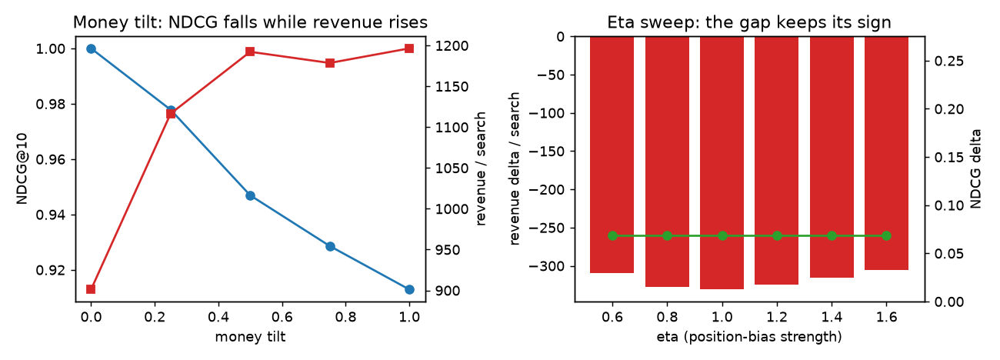

Главный результат защищён от очевидного возражения — «это следствие конкретной
кривой осмотра». Два свипа:

| Свип | Сетка | Что происходит |
|---|---|---|
| Сила смещения позиции | η ∈ {0.6, 0.8, 1.0, 1.2, 1.4, 1.6} | ΔNDCG = **+0.069** на каждой точке, Δвыручки = −309.7 … −330.1 — знак не меняется |
| Наклон к деньгам | `money_tilt` ∈ [0, 1] | NDCG падает 1.000 → 0.913, выручка растёт 901.2 → 1,196.4 — монотонно в противоположные стороны |

Вердикт свипа: дивергенция **не исчезает** на η ∈ [0.6, 1.6]. ΔNDCG вообще не зависит
от η — порядок, построенный по релевантности, от кривой осмотра не меняется, — а
денежный разрыв колеблется в пределах ~8% и ни разу не подходит к нулю.

> **Что это значит.** Расхождение метрики и выручки — свойство постановки, а не
> подобранного параметра. Свип по наклону к деньгам показывает то же самое в
> непрерывном виде: это один и тот же компромисс, который вы двигаете ручкой, а не
> два разных мира.

### Смещение позиции реально и корректируется

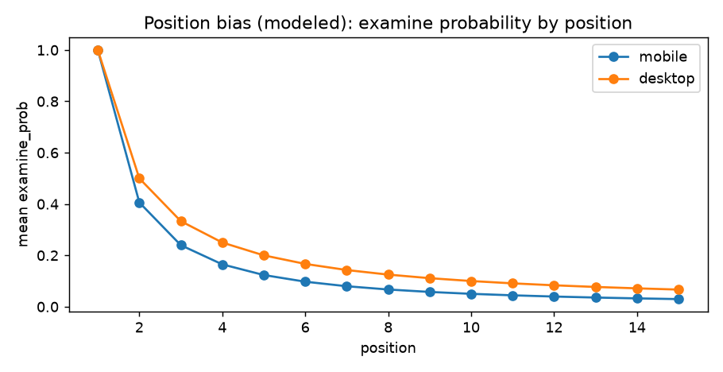

| Величина | Значение |
|---|---|
| Наивный CTR (клики / показы) | 0.163 |
| Истинный CTR без эффекта позиции | 0.629 |
| IPW-коррекция, кривая осмотра известна | 0.625 |
| IPW-коррекция, кривая оценена через EM | 0.629 |

Наивный CTR занижает истинную склонность к клику **почти в 4 раза**: верхние позиции
осматривают заметно чаще. Обратное взвешивание по вероятности (Horvitz–Thompson)
против кривой осмотра `(1/k)^η` возвращает истину; EM-вариант делает то же самое, не
зная кривой заранее.

> **Что это значит.** Любое сравнение ранкеров по сырому CTR смещено по построению.
> Лечится не «метрикой получше», а поправкой на позицию — причём EM-вариант снимает
> требование знать кривую как ground truth.

### Воронка и затухание выручки по позициям

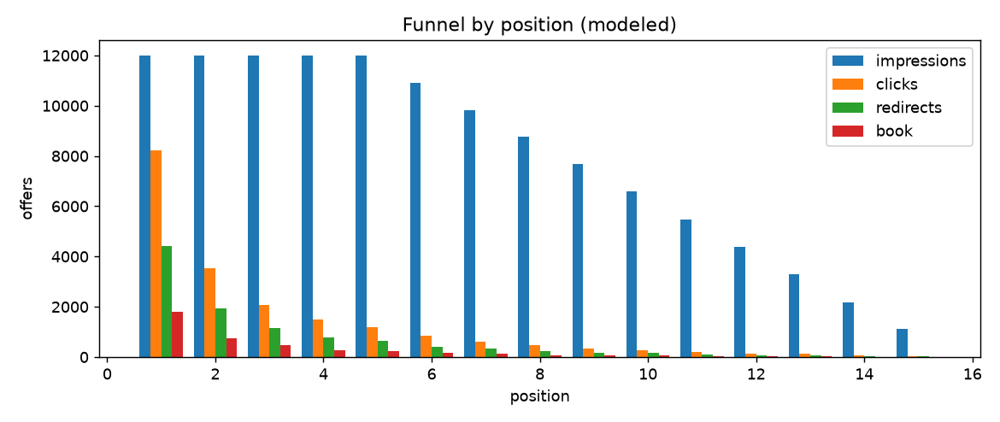

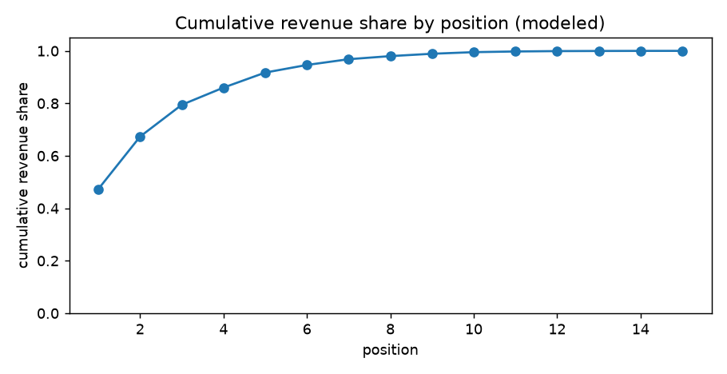

Позиция 1 делает почти всю работу: кривая осмотра схлопывается как `(1/k)^η` уже
через несколько слотов, и на верх страницы приходится **47.3%** всей выручки. Кривая
накопленной доли — это и есть аргумент в переговорах о том, сколько стоит реальная
площадь слота для партнёра.

> **Что это значит.** Выручка на слот не линейна по позиции — ценность падает
> быстрее, чем растёт номер. Прайсить слоты партнёрам (и ставить комиссионный пол)
> нужно по кривой накопленной доли, а не по плоскому тарифу за показ.

### Какие партнёры оправдывают слот

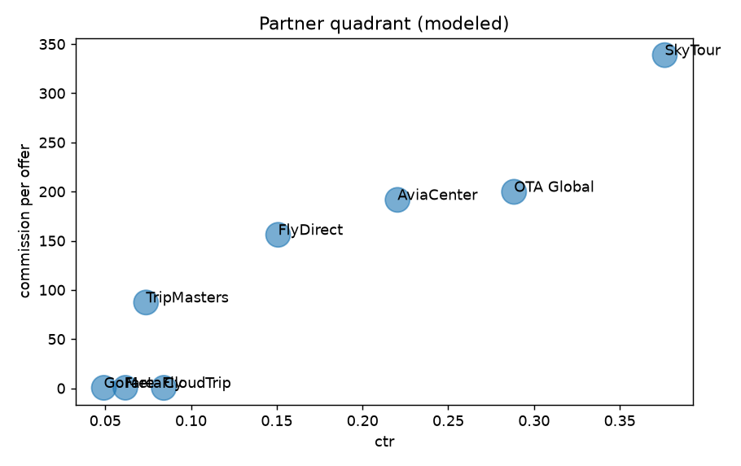

| Партнёр | Средняя позиция | CTR | Комиссия / поиск | Ранг |
|---|---|---|---|---|
| SkyTour | 2.75 | 0.376 | **862.6** | 1 |
| OTA Global | 4.08 | 0.288 | 511.7 | 2 |
| AviaCenter | 3.99 | 0.220 | 489.8 | 3 |
| FlyDirect | 4.81 | 0.151 | 396.0 | 4 |
| TripMasters | 6.15 | 0.074 | 227.2 | 5 |
| MetaFly | 8.78 | 0.062 | 1.25 | 6 |
| GoFare | 9.56 | 0.049 | 1.14 | 7 |
| CloudTrip | 7.91 | 0.084 | 0.97 | 8 |

Монетизация распределена крайне неравномерно. Топ-5 партнёров дают **99.3%** всей
комиссии, а нижние три (MetaFly, GoFare, CloudTrip) стоят на позициях 8–9.5 и
возвращают около **1 единицы на поиск**: трафик они забирают, выручку почти не
приносят, потому что их комиссия на предложение ниже 0.5 против сотен у лидеров.

> **Что это значит.** Слот стоит столько, сколько платит его партнёр, а не столько,
> каков его CTR. Квадрант отделяет высокий CTR при высокой комиссии (держать и
> продвигать) от глубоких слотов с почти нулевой комиссией (кандидаты на удаление) —
> политика ранжирования сама такого решения не покажет.

### Ридаут эксперимента

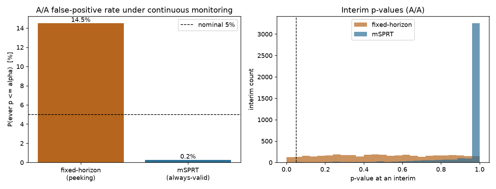

| Проверка | Результат | Чтение |
|---|---|---|
| SRM против плановых 90/10 | χ² = 0.119, **p = 0.730** | Сплит в порядке |
| SRM против наивного предположения 50/50 | χ² = 2947, p ≈ 0 | Неверно предположение, а не сплит |
| A/A-тест | **p = 0.721** | Ложного срабатывания на нулевой разнице нет |
| Ratio-метрика, дельта-метод | diff −77.2, SE 69.0, p = 0.264 | Незначимо |
| Та же метрика, наивно по юнитам | SE 88.5, p = 0.449 | Наивная SE **в 1.28 раза шире** |
| CUPED, реальная pre-period ковариата | corr −0.006 → **+0.0%** к снижению дисперсии | i.i.d.-пользователи: эксплуатировать нечего |
| CUPED, коррелированный позитивный контроль | corr 0.335 → **+11.2%** к снижению дисперсии | Воспроизводит теоретическое ρ² |
| Подглядывание, фиксированный горизонт α = 0.05 | FPR **14.5%** за 10 взглядов | В 2.9 раза выше номинала |
| Подглядывание, always-valid mSPRT | FPR **0.25%** | Инфляционный множитель 58× |

Всего 1,491 и 1,098 побед при 1,411 ничьих в interleaving-сравнении (4,000
пользователей) — тест отдаёт решение в пользу A с win rate 37.3% против 27.5%;
это позиционно-устойчивая альтернатива сырому CTR.

> **Что это значит.** Три ловушки на одной странице. Сплит 90/10 нормален, но
> *предположение* о 50/50 сфабриковало бы ложную тревогу SRM; ratio-метрике нужен
> дельта-метод, иначе её погрешность завышена в 1.28 раза; а десять взглядов на
> p-value фиксированного горизонта раздувают долю ложных срабатываний до 14.5% —
> always-valid mSPRT удерживает её на 0.25%, но ценой в 58 раз более широкого порога.

### Необходимый размер выборки

| Распределение | n всего | Контроль | Тест |
|---|---|---|---|
| 90/10 (плановое) | **55,196** | 49,676 | 5,520 |
| 50/50 | 19,871 | 9,935 | 9,935 |

Сплит 90/10 стоит **в 2.78 раза** больше трафика при той же мощности — это реальная
цена защиты подавляющего большинства пользователей от изменения.

> **Что это значит.** Размер выборки — бюджетная строка всей программы
> экспериментов. Выбор 90/10 — продуктовое решение с множителем трафика 2.78×, а не
> статистическая деталь.

### Измеренные острова: заказы, предложение, маршруты

Графики этого подраздела построены на **реальных** лентах (`orders`,
`bookings_legs`, `events`, `sessions`,), а не на синтетическом слое SERP. Они
описывают бизнес бронирований, а не страницу результатов.

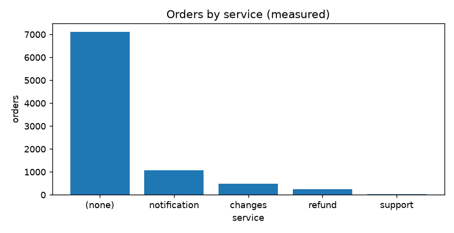

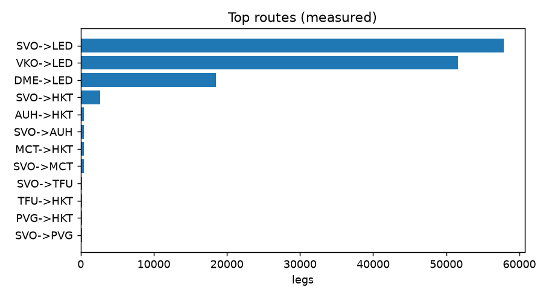

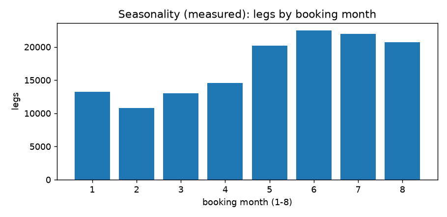

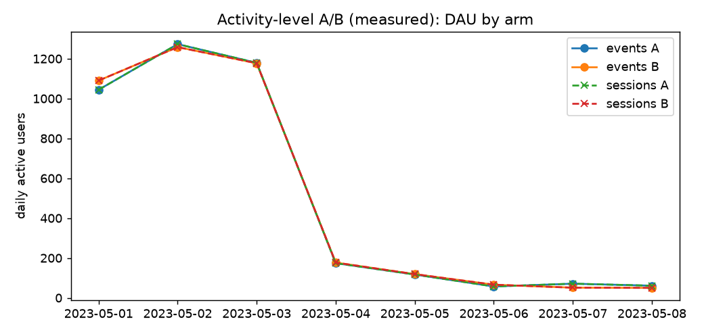

<details>
<summary>Ещё два измеренных графика — возвраты и география</summary>

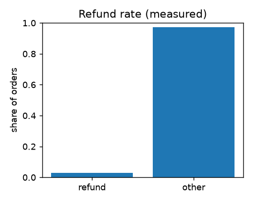

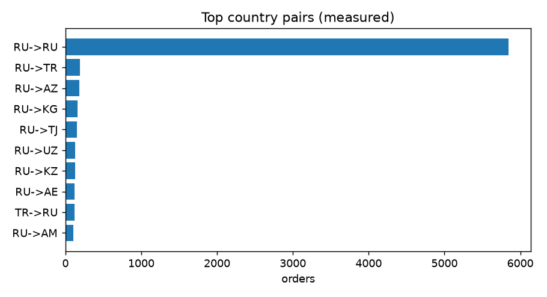

</details>

> **Что это значит.** `orders` и `bookings_legs` — острова: внешнего ключа к
> кликстриму в них нет, поэтому их отчитывают отдельно и никогда не сливают со
> смоделированными метриками SERP. Измеренная A/B-вкладка — единственное место, где
> реальный кликстрим соприкасается с раздачей плечей.

## Выводы

1. **Офлайн-метрика и деньги — не одно и то же.** NDCG-оптимум проигрывает
   revenue-оптимуму ~328 единиц комиссии на поиск, и этот разрыв не зависит от силы
   смещения позиции. Релизный гейт по офлайн-метрике систематически выбирает не ту
   политику.
2. **Смещение позиции корректируемо, и это окупается.** Сырой CTR занижает истинную
   склонность к клику почти в 4 раза, а обучение клик-модели на IPW-взвешенных логах
   даёт +19.3% выручки при том же фиттере — без единой новой фичи.
3. **Выручка концентрируется наверху страницы.** Позиция 1 даёт 47.3% выручки, топ-5
   партнёров — 99.3% комиссии. Хвост выдачи при этом забирает трафик и почти не
   платит.
4. **Статистические ловушки стоят дороже, чем кажется.** Наивная SE для ratio-метрики
   шире в 1.28 раза, повторные взгляды на p-value раздувают FPR до 14.5%, а CUPED на
   i.i.d.-пользователях не даёт ничего (0.0%, против 11.2% на коррелированном
   контроле).
5. **Дизайн эксперимента — продуктовая статья расходов.** 90/10 стоит 2.78× трафика
   против 50/50 при той же мощности, то есть выбор сплита — это решение о том,
   сколько пользователей вы готовы подвергнуть изменению.
6. **Смоделированный слой честно размечен как смоделированный.** Реальных логов
   показов для этой поверхности нет, поэтому resemblance синтетического SERP к
   продовому трафику — это *допущение*, а не измерение; якоря симулятора
   (разброс цен внутри маршрута, календарь) выводятся из измеренных островов.

## Рекомендации

| Решение | Почему | На чём основано |
|---|---|---|
| Сделать северной звездой ранжирования выручку на поиск | Офлайн-NDCG и клики растут там, где падает комиссия | Δ −327.7 на поиск, свип держит знак на η ∈ [0.6, 1.6] |
| Обучать клик-модель на IPW-взвешенных логах | Тот же фиттер, +19.3% выручки и выше NDCG — улучшение бесплатное | `propensity_logistic` 826.6 против `click_trained` 693.0 |
| Сравнивать ранкеры онлайн через interleaving или IPW-поправку | Сырой CTR смещён почти в 4 раза по построению | Naive 0.163 против истинного 0.629; interleaving даёт решение A при 1,491 : 1,098 |
| Прайсить слоты по кривой накопленной выручки | Ценность слота падает быстрее, чем растёт номер позиции | Позиция 1 = 47.3% выручки |
| Пересмотреть партнёров на позициях 8–9.5 | ~1 единица на поиск при CTR 5–8%: трафик без денег | MetaFly 1.25, GoFare 1.14, CloudTrip 0.97; топ-5 = 99.3% комиссии |
| Оставить 90/10, приняв множитель трафика осознанно | Защищает 90% пользователей, но требует 2.78× трафика | 55,196 против 19,871 наблюдений |
| Не смотреть на p-value повторно без последовательного теста | Десять взглядов поднимают FPR до 14.5% | mSPRT держит 0.25% при пороге в 58 раз шире |
| Считать ratio-метрики дельта-методом | Наивный тест завышает погрешность и может перевернуть решение | SE 88.5 против 69.0 (1.28×) |
| Включать CUPED только при реально коррелирующей pre-period | На i.i.d.-пользователях выигрыш нулевой | 0.0% на реальной ковариате, 11.2% на позитивном контроле |
| Проверять MDE до запуска | Эффект меньше MDE при текущем трафике не поймать | Требуется 55,196 наблюдений на эффект +5% |

## Данные

| Датасет | Файл | Строк | Гранулярность |
|---|---|---|---|
| Брони (Aviastats) | `data.csv` | 135,508 | бронь, развёрнутая в 137,082 строки сегментов |
| Заказы платных услуг | `booking_analytics_test_df.csv` | 8,966 | заказ × услуга |
| Продуктовые события | `task_1_events.csv` | 44,568 | сырое событие (пользователь × время) |

135,508 броней несут 137,082 сегмента; 1,574 брони содержат стыковку. В данных 24
авиакомпании, 11 пунктов отправления и 10 пунктов назначения. JSON сегментов
**разрежен**: у 1,679 сегментов нет `airline`, у 1,697 нет `origin`, у 1,696 нет
`destination`, у 1,772 нет ключа `baggage`. Отсутствующие `origin`/`destination`/
`airline` сохраняются как `pd.NA` (nullable `string`) и никогда не импутируются;
только `baggage` по умолчанию превращается в `"No baggage"`, чтобы `has_baggage`
остался ненулевым булевым.

**Сырые сторонние данные в репозиторий не коммитятся.** Это записи о бронированиях,
выданные под тестовое задание. Здесь лежат только *загрузчик*
(`src/data_ingest.py`), генератор синтетического SERP и SQL; `data/processed/*.parquet`,
`data/raw/*` и `reports/*` — в `.gitignore`.

Чтобы прогнать пайплайн на реальных лентах, укажите на них загрузчик:

```bash
export AVIASALES_SOURCE_DIR="/path/to/Aviasales"   # содержит 3 подкаталога
```

Каталог должен содержать `Aviastats Аналитик/`, `Booking — Продуктовый аналитик/` и
`Продуктовый аналитик-2/`. Либо передайте `--source-dir`, либо положите файлы в
`data/raw/` и положитесь на путь по умолчанию. Без лент стадия `ingest` падает
громко (так и задумано) — но стадии SERP, ранжирования и эксперимента целиком
работают на закоммиченном синтетическом слое.

Один опциональный тест (`tests/test_stats.py`) сверяет вендоренную статистику с
реальным ответом соседнего проекта; он скипается, пока не задан `AVIASALES_AB_CTR_DIR`.

## Методы

- **Модель смещения позиции (PBM).** Вероятность осмотра убывает с позицией как
  `(1/k)^η`, `η = 1.3` на мобильных / `1.0` на десктопе. Клик = «осмотрел × релевантно».
- **Несмещённый CTR.** Обратное взвешивание по вероятности (Horvitz–Thompson): кривая
  либо известна, либо восстанавливается через EM.
- **Метрики ранжирования.** NDCG@10 по градуированной релевантности, MRR, плюс
  team-draft interleaving как онлайн-альтернатива, устойчивая к смещению позиции.
- **Ratio-метрики.** Выручка на поиск — отношение сумм, поэтому для её дисперсии нужен
  дельта-метод; наивный тест по юнитам здесь и неверен, и консервативен.
- **CUPED.** Ковариата — выручка на поиск за предпериод, с перемешанной ковариатой как
  мутационным контролем.
- **Последовательное тестирование.** p-value фиксированного горизонта при повторных
  взглядах сравниваются с always-valid mSPRT, чтобы измерить цену подглядывания.
- **Якорение симулятора.** `src/calibration.py` вытаскивает якоря **только из
  реальных островов** и записывает их **только в ручки симулятора** (разброс цен
  внутри маршрута → `price_sigma`, доли месяцев → календарь). Ни одна строка реальных
  данных не попадает в `serp_offers`, так что граница «смоделировано / измерено» не
  нарушается. Клик-модель, таблица партнёров и ставки комиссии из островов
  **не идентифицируемы** — модуль этого и не заявляет.

## Быстрый старт

```bash
uv sync --all-groups
uv run python run.py --stage all      # ingest → sessions → serp → sql → rank → experiment → business
uv run pytest -q                      # 110 тестов (108 проходят, 2 скипаются без соседних данных)
uv run ruff check . && uv run ruff format --check .
uv run streamlit run app.py           # дашборд на :8501
```

`--stage` принимает `ingest`, `sessions`, `serp`, `rank` (алиас `eval`), `experiment`
или `all`.

В дашборде семь страниц — Funnel, Revenue by position, Ranking policies, Position bias
& partners, Ancillary & refunds, Supply & routes, Experiment — поверх тех же Parquet и
JSON, что пишет пайплайн.

## Статус

Все три фазы завершены.

| Фаза | Объём | Состояние |
|---|---|---|
| 1 | Основа данных: ingest, разворот сегментов, нормализующий SQL, сессионизация | Готово |
| 2 | Симулятор ранжирования SERP поверх `serp_offers` + оценка ранжирования | Готово |
| 3 | A/B-эксперимент над политикой ранжирования + дашборд | Готово |
| 4 | «Боевые» политики, свип чувствительности, якорение симулятора, `interleaving` | Реализовано и покрыто тестами; в `run.py` не подключено |

Проверено: `uv sync --all-groups` разрешается; `uv run python run.py --stage all`
проходит end-to-end; `uv run pytest -q` даёт **108 passed, 2 skipped** (два скипаются
без опциональных соседних данных); `uv run ruff check .` и `uv run ruff format --check .`
чисты; `uv run streamlit run app.py` отдаёт страницу на `localhost:8501`.

**Не проверено / допущение:** то, что синтетический слой SERP похож на реальный
продовый трафик, — это *допущение*, а не измерение: реального лога показов для этой
поверхности не существует. `sql/03_funnel.sql` написан против отношения
`serp_offers` и исполняется, когда этот Parquet зарегистрирован, но в `run.py` он не
подключён. `sql/01_normalize.sql` и `sql/02_sessions.sql` пайплайном **исполняются**.

## Структура

```
serp-rank-lab/
├── pyproject.toml
├── .gitignore
├── README.md
├── PRD.md                  # требования к продукту
├── CONTEXT.md              # глоссарий — точное значение каждого термина
├── LICENSE
├── run.py                  # точка входа пайплайна
├── app.py                  # дашборд Streamlit
├── src/
│   ├── data_ingest.py      # загрузчики + разворот сегментов + запись parquet + CLI
│   ├── sessions.py         # сессионизация на DuckDB
│   ├── serp_sim.py         # синтетические страницы результатов + клик-модель PBM
│   ├── calibration.py      # якорение ручек симулятора по измеренным островам
│   ├── policies.py         # оракульные и «боевые» политики ранжирования
│   ├── ranking_eval.py     # несмещённый CTR, NDCG/MRR, interleaving
│   ├── stats.py            # вендоренная статистика эксперимента
│   ├── experiment.py       # SRM, A/A, дельта-метод, CUPED, mSPRT
│   ├── business.py         # отчёт по измеренным заказам / предложению / маршрутам
│   ├── sql_stage.py        # прогон sql/03 + sql/04 против serp_offers
│   └── plots.py            # сборка графиков matplotlib
├── sql/
│   ├── 01_normalize.sql    # нормализующие представления сегментов / заказов / событий
│   ├── 02_sessions.sql     # правило сессии: 30 минут неактивности + граница суток
│   ├── 03_funnel.sql       # поиск → клик → переход → покупка
│   └── 04_revenue_per_search.sql
├── notebooks/
│   ├── 01_ranking_monetisation.ipynb
│   └── 02_business_revenue.ipynb
├── docs/
│   └── adr/0001-modeled-vs-measured.md   # граница слияния и почему она такая
├── tests/                  # 110 тестов
├── data/
│   ├── raw/                # только .gitkeep — реальные данные не коммитятся
│   └── processed/          # сгенерированный parquet (в .gitignore)
└── reports/
    ├── figures/            # закоммиченные графики, использованные в этом README
    └── *.json, *.png       # сгенерированные отчёты (в .gitignore)
```

## Происхождение

Статистика в `src/stats.py` вендорена из собственного тулкита автора
`ab_test/scripts/` и сверена с задокументированными ответами соседнего A/B-проекта
(см. `tests/test_stats.py`). Всё остальное написано для этой лаборатории.

Лицензия MIT — см. `LICENSE`.

## Связанное

- **Дашборд:** `uv run streamlit run app.py` — интерактивная поверхность над теми же выходными данными.
- **Глоссарий:** [`CONTEXT.md`](CONTEXT.md) — точное значение каждого термина, использованного выше.
- **Заметка о дизайне:** [`docs/adr/0001-modeled-vs-measured.md`](docs/adr/0001-modeled-vs-measured.md) — почему смоделированные и измеренные данные никогда не сливаются.
- **Автор:** [Nikita Boyarkin](https://github.com/NikitaBoyarkin) — портфель проектов продуктовой аналитики.
