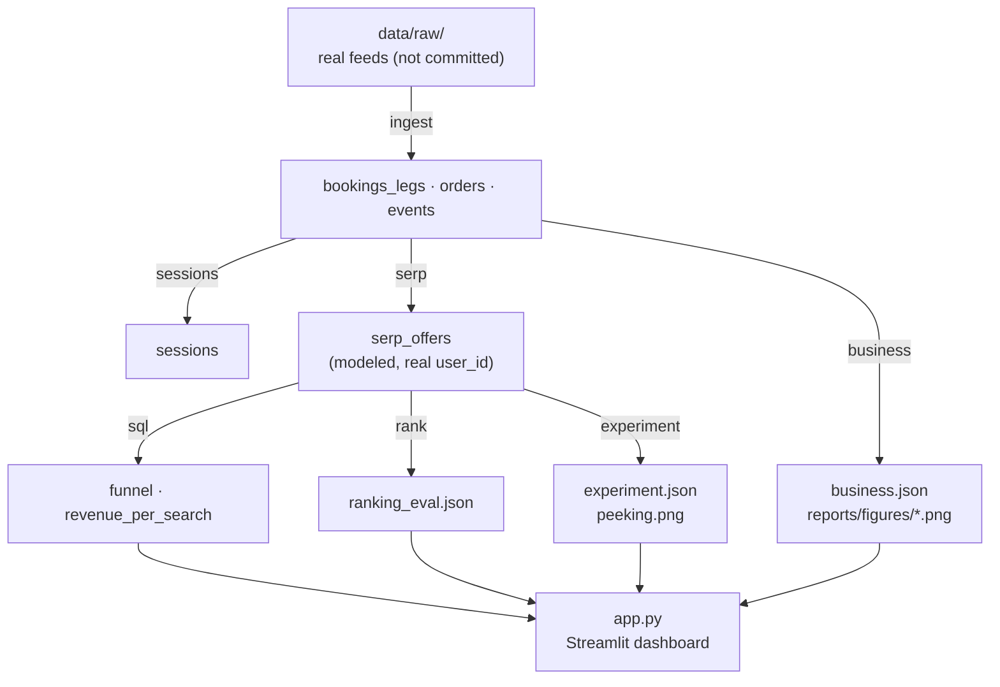

# SERP Rank Lab

A flight-metasearch **search-results-page** analytics lab: ranking, position bias,
partner monetisation and A/B readout for the surface where a metasearch product
actually earns.

A metasearch site sells no tickets. Its revenue is a partner commission (CPA per
booking) or a cost-per-click, multiplied by **which position** the offer occupied
on the results page. So the two questions that dominate the role are:

1. **Ranking** — which offer deserves which position, and how deep do users
   actually scroll before they convert?
2. **Monetisation** — which partners and which positions earn their slot, and how
   much revenue does a given ranking policy produce per search?

This lab builds the measurement substrate for both, then runs the experiment
machinery on top of it.

## Navigation

- [What it does](#what-it-does)
- [How the pipeline fits together](#how-the-pipeline-fits-together)
- [Results](#results)
  - [Ranking: the offline metric and the money disagree](#ranking-the-offline-metric-and-the-money-disagree)
  - [Position bias is real and correctable](#position-bias-is-real-and-correctable)
  - [Funnel and revenue decay down the page](#funnel-and-revenue-decay-down-the-page)
  - [Which partners earn their slot](#which-partners-earn-their-slot)
  - [Experiment readout](#experiment-readout)
  - [Required sample size](#required-sample-size)
  - [Measured islands: orders, supply and routes](#measured-islands-orders-supply-and-routes)
- [Data](#data)
- [Methods](#methods)
- [Quick start](#quick-start)
- [Status](#status)
- [Layout](#layout)
- [Provenance](#provenance)
- [Related](#related)

## What it does

| Layer | Files | Role |
|---|---|---|
| Data | `src/data_ingest.py`, `sql/01_normalize.sql` | booking feed → one row per flight leg; orders; raw events |
| Sessions | `src/sessions.py`, `sql/02_sessions.sql` | 30-minute inactivity + date-boundary session rule |
| SERP | `src/serp_sim.py` | synthetic results pages over **real** route/price pairs; position-bias click model; CPA/CPC partner economics |
| Evaluation | `src/ranking_eval.py`, `sql/03_funnel.sql`, `sql/04_revenue_per_search.sql` | unbiased CTR, NDCG/MRR, interleaving, revenue per search |
| Experiment | `src/stats.py`, `src/experiment.py` | SRM, A/A, delta method, CUPED, mSPRT, peeking |
| Surface | `app.py`, `run.py` | Streamlit dashboard; single pipeline entry point |

## How the pipeline fits together

Every stage reads from and writes to `data/processed/` as Parquet, so any stage
can be re-run on its own. The **modeled** branch (synthetic SERP over real users)
and the **measured** branch (real feeds) never fuse — see
`docs/adr/0001-modeled-vs-measured.md`.



```bash
uv run python run.py --stage all      # ingest → sessions → serp → sql → rank → experiment → business
```

## Results

All numbers below are reproducible from a fixed seed (`uv run python run.py --stage all`).
Charts live in `reports/figures/` and are regenerated by the pipeline.

### Ranking: the offline metric and the money disagree


| Policy | NDCG@10 | Revenue / search | Clicks / search |
|---|---|---|---|
| Relevance-first | **1.000** | 869.5 | 1.763 |
| Revenue-first | 0.931 | **1,193.7** | 1.596 |
| Δ (relevance − revenue) | **+0.069** | **−324.2** | +0.168 |

Ranking by relevance maximises NDCG *and* clicks, while ranking by revenue earns
**38% more per search**. Optimising the offline metric would have shipped the
worse policy — which is exactly why the ranking team's north star has to be a
revenue-per-search ratio metric, not an offline relevance score.

> **Takeaway.** The two left-panel and right-panel bars move in opposite
> directions on the same policies. An offline-metric-only release gate would have
> picked the policy that loses ~324 in commission per search.

### Position bias is real and correctable


| Quantity | Value |
|---|---|
| Naive CTR (clicks / impressions) | 0.163 |
| True position-free CTR | 0.629 |
| IPW-corrected, known examination curve | 0.625 |
| IPW-corrected, curve estimated by EM | 0.629 |

The naive CTR under-states the true click propensity by **~4×**, because top
positions get examined far more often. Inverse-propensity weighting against the
position examination curve `(1/k)^η` recovers it; the EM variant recovers it
without knowing the curve in advance.

> **Takeaway.** Any raw-click-rate comparison across rankers is biased by
> construction. The fix is not a better click metric but a position-aware
> correction — and the EM variant means you don't need the curve as ground truth.

### Funnel and revenue decay down the page


Position 1 does most of the work: the examination curve collapses to
`(1/k)^η` within a few slots, so both clicks and revenue concentrate at the top of
the page. The cumulative revenue curve is the argument for how much slot real
estate is actually worth to a partner.

> **Takeaway.** Revenue per slot is not linear in position — value drops faster
> than rank number. Pricing partner slots (and setting a commission floor) should
> follow the cumulative-share curve, not a flat per-impression rate.

### Which partners earn their slot


| Partner | Avg position | CTR | Commission / search | Rank |
|---|---|---|---|---|
| SkyTour | 2.75 | 0.376 | **862.6** | 1 |
| OTA Global | 4.08 | 0.288 | 511.7 | 2 |
| AviaCenter | 3.99 | 0.220 | 489.8 | 3 |
| FlyDirect | 4.81 | 0.151 | 396.0 | 4 |
| TripMasters | 6.15 | 0.074 | 227.2 | 5 |
| MetaFly | 8.78 | 0.062 | 1.25 | 6 |
| GoFare | 9.56 | 0.049 | 1.14 | 7 |
| CloudTrip | 7.91 | 0.084 | 0.97 | 8 |

Monetisation is not spread evenly. The top five partners earn **99.3%** of all
commission, while the bottom three (MetaFly, GoFare, CloudTrip) are placed at
positions 8–9.5 and return about **1 per search** — they carry traffic but almost
no revenue, because their commission per offer is under 0.5 against hundreds for
the leaders.

> **Takeaway.** A slot is worth what its partner pays, not what its CTR is. The
> quadrant separates high-CTR/high-commission partners (keep and promote) from
> deep-slot near-zero-commission partners (candidates to drop from the page) — a
> decision the ranking policy alone would not surface.

### Experiment readout


| Check | Result | Reading |
|---|---|---|
| SRM vs planned 90/10 | χ² = 0.119, **p = 0.730** | Split is sound |
| SRM vs a naive 50/50 assumption | χ² = 2947, p ≈ 0 | The assumption, not the split, is wrong |
| A/A test | **p = 0.721** | No false positive on a null difference |
| Ratio metric, delta method | diff −77.2, SE 69.0, p = 0.264 | Not significant |
| Same metric, naive per-unit | SE 88.5, p = 0.449 | Naive SE is **1.28× too wide** |
| CUPED, real pre-period covariate | corr −0.006 → **+0.0%** variance cut | i.i.d. users: nothing to exploit |
| CUPED, correlated positive control | corr 0.335 → **+11.2%** variance cut | Recovers the theoretical ρ² reduction |
| Peeking, fixed-horizon α = 0.05 | FPR **14.5%** over 10 looks | 2.9× the nominal rate |
| Peeking, mSPRT always-valid | FPR **0.25%** | Inflation factor 58× |

> **Takeaway.** Three traps on one page. A 90/10 split is fine but a 50/50
> *assumption* would fake an SRM alarm; a ratio metric needs the delta method or
> its error bar is 1.28× too wide; and watching a fixed-horizon p-value ten times
> inflates the false-positive rate to 14.5% — the always-valid mSPRT holds it at
> 0.25%, at the price of a 58× wider threshold.

### Required sample size

| Allocation | n total | Control | Test |
|---|---|---|---|
| 90/10 (planned) | **55,196** | 49,676 | 5,520 |
| 50/50 | 19,871 | 9,935 | 9,935 |

The 90/10 split costs **2.78×** the traffic of an even split for the same power —
the real price of protecting the overwhelming majority of users from a change.

> **Takeaway.** Sample size is the budget line for the whole experiment programme.
> Choosing 90/10 is a product decision with a 2.78× traffic multiplier attached,
> not a statistical detail.

### Measured islands: orders, supply and routes

Charts in this subsection are built from the **real** feeds (`orders`,
`bookings_legs`, `events`, `sessions`) — not from the synthetic SERP layer. They
describe the booking business, not the results page.


<details>
<summary>Two more measured charts — refunds and geography</summary>


</details>

> **Takeaway.** `orders` and `bookings_legs` are islands — they carry no foreign
> key to the clickstream — so they are reported separately and never fused with the
> modeled SERP metrics. The measured A/B tab is the only place the real clickstream
> touches an arm assignment.

## Data

| Dataset | File | Rows | Grain |
|---|---|---|---|
| Bookings (Aviastats) | `data.csv` | 135,508 | booking, exploded to 137,082 leg rows |
| Paid-service orders | `booking_analytics_test_df.csv` | 8,966 | order × service |
| Product events | `task_1_events.csv` | 44,568 | raw event (user × timestamp) |

The 135,508 bookings carry 137,082 legs; 1,574 bookings contain a connection.
24 airlines, 11 origins and 10 destinations appear. The leg JSON is **ragged** —
1,679 legs have no `airline`, 1,697 no `origin`, 1,696 no `destination` and 1,772
no `baggage` key. Absent `origin`/`destination`/`airline` are preserved as `pd.NA`
(nullable `string`), never imputed; `baggage` alone defaults to `"No baggage"` so
`has_baggage` stays a non-nullable boolean.

**Raw third-party data is NOT committed to this repository.** These are booking
records supplied for an interview assignment. Only the *loader*
(`src/data_ingest.py`), the synthetic SERP generator, and the SQL are here; the
`data/processed/*.parquet`, `data/raw/*` and `reports/*` outputs are gitignored.

To run the pipeline against the real feeds, point the loader at them:

```bash
export AVIASALES_SOURCE_DIR="/path/to/Aviasales"   # holds the 3 subdirectories
```

The directory must contain `Aviastats Аналитик/`, `Booking — Продуктовый аналитик/`
and `Продуктовый аналитик-2/`. Alternatively pass `--source-dir`, or drop the
files under `data/raw/` and rely on the default. Without the feeds, the ingest
stage fails loudly (by design) — but the SERP, ranking and experiment stages run
entirely on the committed synthetic layer.

One option test (`tests/test_stats.py`) cross-checks the vendored statistics
against a sibling project's real answer; it skips unless you set
`AVIASALES_AB_CTR_DIR` to that project.

## Methods

- **Position-bias model (PBM).** Examination probability decays with position as
  `(1/k)^η`, `η = 1.3` mobile / `1.0` desktop. Clicks are `examined × relevance`.
- **Unbiased CTR.** Horvitz–Thompson inverse-propensity weighting, with the curve
  either known or fitted by EM.
- **Ranking metrics.** NDCG@10 on graded relevance, MRR, plus team-draft
  interleaving as the online (position-bias-robust) alternative.
- **Ratio metrics.** Revenue per search is a ratio of sums, so it needs the delta
  method for its variance — the naive per-unit test is both wrong and conservative
  here.
- **CUPED.** Pre-period revenue per search as the covariate, with a shuffled
  covariate as a mutation control.
- **Sequential testing.** Fixed-horizon p-values under repeated looks are compared
  against an always-valid mSPRT to quantify the peeking penalty.

## Quick start

```bash
uv sync --all-groups
uv run python run.py --stage all      # ingest → sessions → serp → sql → rank → experiment → business
uv run pytest -q                      # 80 tests (78 pass, 2 skip without sibling data)
uv run ruff check . && uv run ruff format --check .
uv run streamlit run app.py           # dashboard on :8501
```

`--stage` accepts `ingest`, `sessions`, `serp`, `rank` (alias `eval`), `experiment`
or `all`.

The dashboard has seven pages — Funnel, Revenue by position, Ranking policies,
Position bias & partners, Ancillary & refunds, Supply & routes, Experiment — over
the same Parquet and JSON the pipeline writes.

## Status

All three phases complete.

| Phase | Scope | State |
|---|---|---|
| 1 | Data foundation: ingest, leg explosion, normalisation SQL, sessionisation | Done |
| 2 | SERP ranking simulator over `serp_offers` + ranking evaluation | Done |
| 3 | A/B experiment on the ranking policy + dashboard | Done |

Verified: `uv sync --all-groups` resolves; `uv run python run.py --stage all` runs
end-to-end; `uv run pytest -q` is **78 passed, 2 skipped** (the 2 skip without the
optional sibling data); `uv run ruff check .` and `uv run ruff format --check .` are clean;
`uv run streamlit run app.py` serves on `localhost:8501`.

**Not verified / inference:** the synthetic SERP layer resembling real production
traffic is an *inference*, not a measurement — no real impression log exists for
this surface. `sql/03_funnel.sql` is written against the `serp_offers` relation and
executes when that Parquet is registered, but it is not wired into `run.py`.
`sql/01_normalize.sql` and `sql/02_sessions.sql` **are** executed by the pipeline.

## Layout

```
serp-rank-lab/
├── pyproject.toml
├── .gitignore
├── README.md
├── PRD.md                  # product requirements
├── CONTEXT.md              # glossary — precise meaning of every term
├── LICENSE
├── run.py                  # pipeline entry point
├── app.py                  # Streamlit dashboard
├── src/
│   ├── data_ingest.py      # loaders + leg explosion + parquet writer + CLI
│   ├── sessions.py         # DuckDB-backed sessionisation
│   ├── serp_sim.py         # synthetic results pages + PBM click model
│   ├── ranking_eval.py     # unbiased CTR, NDCG/MRR, interleaving
│   ├── stats.py            # vendored experiment statistics
│   ├── experiment.py       # SRM, A/A, delta method, CUPED, mSPRT
│   ├── business.py         # measured order / supply / route reporting
│   ├── sql_stage.py        # runs sql/03 + sql/04 against serp_offers
│   └── plots.py            # matplotlib figure builders
├── sql/
│   ├── 01_normalize.sql    # flight legs / orders / events normalisation views
│   ├── 02_sessions.sql     # 30-min inactivity + date-boundary session rule
│   ├── 03_funnel.sql       # search → click → redirect → buy
│   └── 04_revenue_per_search.sql
├── notebooks/
│   ├── 01_ranking_monetisation.ipynb
│   └── 02_business_revenue.ipynb
├── docs/
│   └── adr/0001-modeled-vs-measured.md   # the fusion boundary, and why
├── tests/                  # 80 tests
├── data/
│   ├── raw/                # .gitkeep only — real data is not committed
│   └── processed/          # generated parquet (gitignored)
└── reports/
    ├── figures/            # committed charts used in this README
    └── *.json, *.png       # generated reports (gitignored)
```

## Provenance

The statistics in `src/stats.py` are vendored from the author's own
`ab_test/scripts/` toolkit and cross-checked against a sibling A/B project's
documented answers (see `tests/test_stats.py`). Everything else is written for
this lab.

Licensed under the MIT License — see `LICENSE`.

## Related

- **Dashboard:** `uv run streamlit run app.py` — the interactive surface over the same outputs.
- **Glossary:** [`CONTEXT.md`](CONTEXT.md) — the precise meaning of every term used above.
- **Design note:** [`docs/adr/0001-modeled-vs-measured.md`](docs/adr/0001-modeled-vs-measured.md) — why modeled and measured data never fuse.
- **Author:** [Nikita Boyarkin](https://github.com/NikitaBoyarkin) — portfolio of product-analytics projects.
